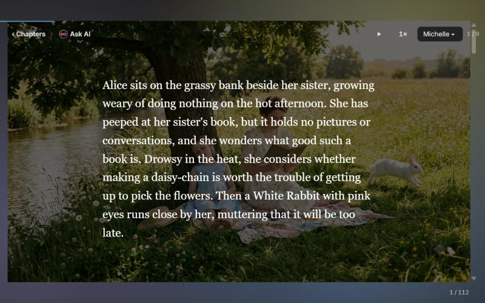
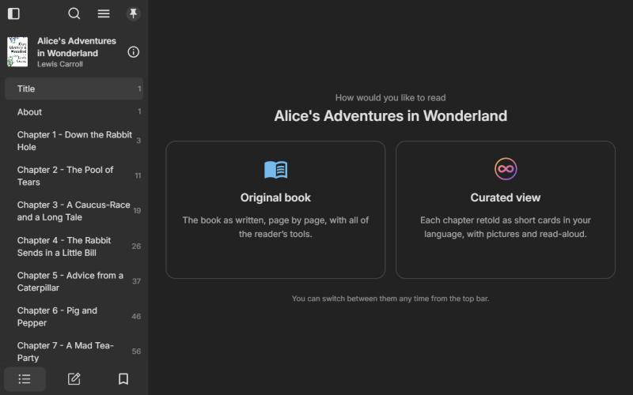
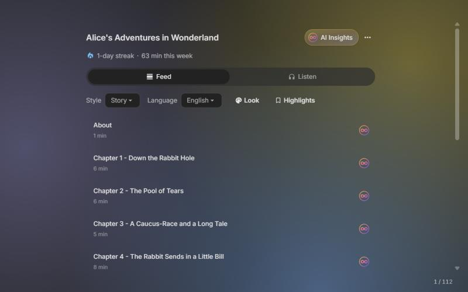
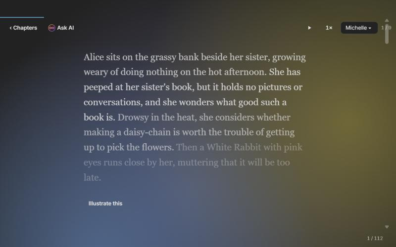
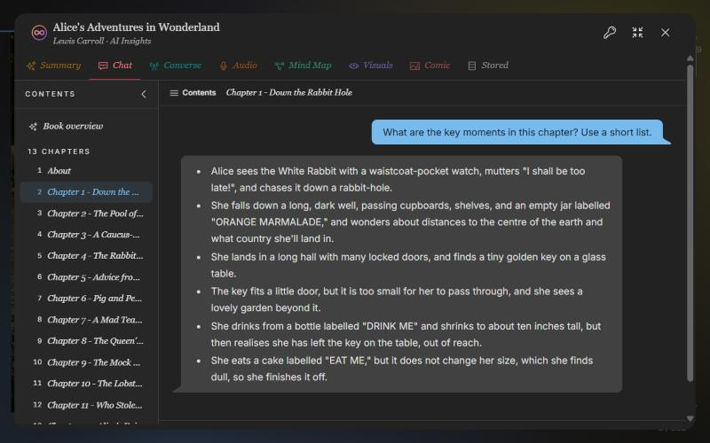
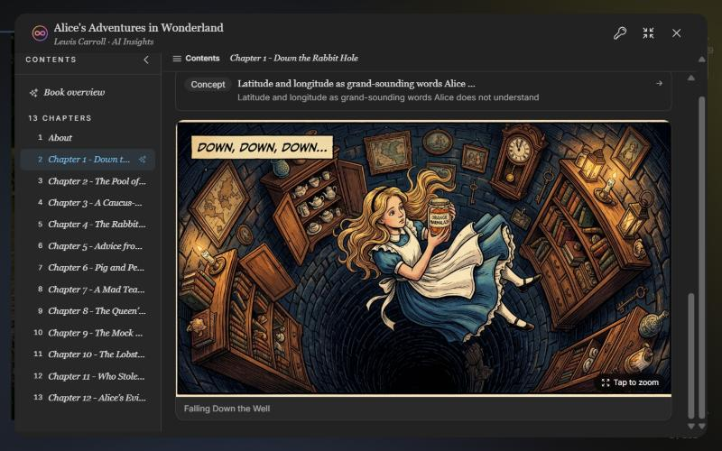
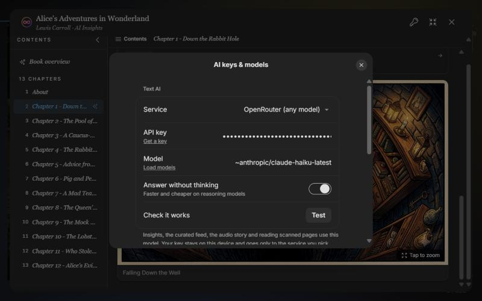

<div align="center">
  <h1>ShortReader</h1>
  <p><strong>Read any book the way you want: the original pages, or a curated, card-by-card retelling with pictures and read-aloud.</strong></p>
  <p>Bring your own AI key and model. Pictures from Google Flow or Grok Imagine.</p>

[](https://github.com/plaethos99/shortreader/releases)
[](#download)
[](LICENSE)

</div>

<p align="center">
  
</p>

<p align="center">
  <a href="#features">Features</a> •
  <a href="#screenshots">Screenshots</a> •
  <a href="#download">Download</a> •
  <a href="#getting-started">Getting started</a> •
  <a href="#build-from-source">Build from source</a> •
  <a href="#license">License</a>
</p>

---

ShortReader is an open-source ebook reader for Windows, macOS, Android and the
web. Open a book and choose how to read it: the **original book**, with a full
reader's tools, or the **curated view**, where every chapter is retold as a
scroll of short cards in your language, illustrated and read aloud.

There is no account and no subscription. **You bring your own AI**: paste a key
from OpenRouter, OpenAI, Anthropic, Google, xAI, DeepSeek or another service,
pick any model it offers, and that's what ShortReader uses. Your key stays on
your device.

ShortReader is built on [Readest](https://github.com/readest/readest), so the
original-book reader has everything Readest has.

## Features

| | |
| --- | --- |
| **Original or curated, per book** | The first time you open a book, choose *Original book* or *Curated view*. The choice is remembered, and you can switch any time. |
| **Curated view** | Each chapter retold as short cards, with a style that fits the book (story, concepts, techniques, key ideas), in **31 languages**: English, Hindi, Bengali, Telugu, Marathi, Tamil, Gujarati, Kannada, Malayalam, Urdu, Spanish, French, German, Japanese, Chinese, Arabic and more. Quotes stay word for word in the book's language. |
| **Read-along** | Cards are read aloud with natural Microsoft Edge voices, sentence by sentence, in the card's language. |
| **Listen** | The whole book as an hour-long audio story. |
| **AI Insights** | Book overview, chapter overviews, key quotes, themes and concepts, plus chat with the book, all with properly formatted answers and math. |
| **Pictures** | Mind maps, chapter visuals, comic panels and card illustrations, made in **Google Flow** or **Grok Imagine**, your choice. ShortReader opens the site in its own browser window; sign in once and pictures are made by themselves. |
| **Bring your own key** | OpenRouter (nearly every model with one key), OpenAI, Anthropic, Google Gemini, xAI, DeepSeek, Groq, Mistral, Together, Ollama on your computer, or any OpenAI-compatible service. Load the model list, pick one, test it. |
| **Scanned books** | Pages that are pictures of text are read by your model (needs one that reads images). |
| **Everything Readest does** | EPUB, PDF, MOBI, AZW3, FB2, CBZ, TXT and Markdown; highlights and notes; dictionary and Wikipedia lookup; translation; themes and fonts; sync with WebDAV and other services; screen-reader and keyboard support. |

## Screenshots

*Shown with* Alice's Adventures in Wonderland *(public domain).*

| | |
| :---: | :---: |
|  |  |
| **Original book or curated view**, asked the first time you open a book | **The curated view**: chapters, style, language, Listen |
|  |  |
| **A curated card**, highlighted as it's read aloud | **Illustrate this**: the card's picture, made in Google Flow |
|  |  |
| **AI Insights**: ask about any chapter | **Comic panels, mind maps and visuals** from a chapter's key moments |

<p align="center">
  <br/>
  <b>AI Keys</b>: your service, your key, any model
</p>

## Download

Get the latest build from **[Releases](https://github.com/plaethos99/shortreader/releases)**:

| Platform | File | Notes |
| --- | --- | --- |
| Windows 10/11 | `ShortReader_<version>_x64-setup.exe` | Installer. Windows may warn "Unknown publisher": choose *More info → Run anyway*. |
| Windows (portable) | `ShortReader_<version>_x64-portable.exe` | Runs without installing; keeps its data beside the exe. |
| macOS (Intel + Apple Silicon) | `ShortReader_<version>_universal.dmg` | Not notarized. After copying to Applications, run `xattr -cr /Applications/ShortReader.app` once. |
| Android (64-bit) | `ShortReader_<version>_arm64.apk` | Allow installing from your browser or file manager when asked. Updates install over earlier versions. |

Or run the web version yourself (see [Build from source](#build-from-source)).

## Getting started

1. **Add your AI key.** Library menu (☰) → **AI Keys** → pick a service, paste
   your key, press **Load models**, choose a model, press **Test**.
   [OpenRouter](https://openrouter.ai/keys) is the easiest start: one key, nearly
   every model.
2. **Import a book.** Drag it onto the window, or press **+**.
3. **Open it and choose** *Original book* or *Curated view*.
4. **Pictures** (optional). In **AI Keys → Pictures**, choose Google Flow or Grok
   Imagine. Ask for a picture (*Illustrate this* on a card, or AI Insights → Mind
   map / Visuals / Comic); the site opens in its own Edge or Chrome window. Sign
   in once and the picture appears by itself.

> **On Android**, AI text, the curated view and read-aloud run on the phone.
> Pictures are made on a computer: run the
> [image bridge](tools/image-bridge/README.md) there and enter its address in
> AI Keys.

**Privacy.** Your key is stored only on your device and sent only to the AI
service you chose. Pictures are made with your own Flow or Grok account, in a
browser profile kept separate from your everyday one.

## Build from source

```bash
git clone https://github.com/plaethos99/shortreader.git
cd shortreader
pnpm install
pnpm --filter @readest/readest-app setup-vendors
cd apps/readest-app
cp .env.web.example .env.web && cp .env.tauri.example .env.tauri

pnpm dev-web                                                     # web app on http://localhost:3000
pnpm tauri dev --config src-tauri/shortreader.conf.json          # desktop app
```

You need Node.js 22.18+, pnpm 11, and Rust for the desktop and Android apps.
The full guide covers the source layout, builds for each platform, and making a
release on GitHub (push a `shortreader-v*` tag and GitHub Actions builds
Windows, macOS and Android): see **[HANDOFF.md](HANDOFF.md)**.

| Folder | What's there |
| --- | --- |
| `apps/readest-app` | The app: Next.js front end and Tauri desktop/mobile shell |
| `apps/readest-app/src/services/llm.ts`, `services/byok/` | Bring-your-own-key AI client and settings |
| `apps/readest-app/src/services/scrollfeed/` | The curated view |
| `apps/readest-app/src/services/imagegen/` | Making pictures in Google Flow / Grok Imagine |
| `tools/image-bridge` | Pictures for phones, and an MCP server for AI agents |
| `.github/workflows/shortreader-release.yml` | The release build |

## License

ShortReader is free software under the
[GNU Affero General Public License v3](LICENSE), like
[Readest](https://github.com/readest/readest), on which it is built. If you
distribute a modified version, you must publish its source.

ShortReader uses, among others: [Readest](https://github.com/readest/readest)
(AGPL-3.0), [foliate-js](https://github.com/johnfactotum/foliate-js) (MIT),
[zip.js](https://github.com/gildas-lormeau/zip.js) (BSD-3-Clause),
[fflate](https://github.com/101arrowz/fflate) (MIT),
[PDF.js](https://github.com/mozilla/pdf.js) (Apache-2.0),
[daisyUI](https://github.com/saadeghi/daisyui) (MIT),
[marked](https://github.com/markedjs/marked) (MIT),
[KaTeX](https://github.com/KaTeX/KaTeX) (MIT),
[Next.js](https://github.com/vercel/next.js) (MIT),
[React](https://github.com/facebook/react) (MIT),
[react-icons](https://github.com/react-icons/react-icons) (various open-source licences) and
[Tauri](https://github.com/tauri-apps/tauri) (MIT/Apache-2.0). The Edge
read-aloud token is ported from [edge-tts](https://github.com/rany2/edge-tts).

Fonts: [Bitter](https://fonts.google.com/specimen/Bitter),
[Fira Code](https://fonts.google.com/specimen/Fira+Code),
[Inter](https://fonts.google.com/specimen/Inter),
[Literata](https://fonts.google.com/specimen/Literata),
[Merriweather](https://fonts.google.com/specimen/Merriweather),
[Noto Sans](https://fonts.google.com/specimen/Noto+Sans),
[Roboto](https://fonts.google.com/specimen/Roboto),
[LXGW WenKai](https://github.com/lxgw/LxgwWenKai),
[MiSans](https://hyperos.mi.com/font/en/),
[Source Han](https://github.com/adobe-fonts/source-han-sans/),
[WenQuanYi Micro Hei](http://wenq.org/wqy2/). Thanks to the
[Web Chinese Fonts Plan](https://chinese-font.netlify.app) for its open-source
tools.

Google Flow and Grok Imagine are services of Google and xAI; use them within
their terms, with your own accounts. ShortReader is not affiliated with Google,
xAI, Microsoft or Readest.
